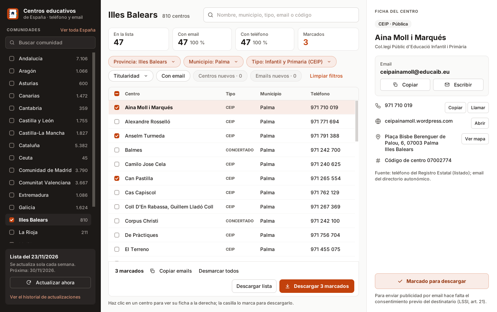

# Centros educativos de España: teléfono y email

Directorio de los **33.555 centros educativos no universitarios de España** con teléfono, email, web, titularidad y tipo de centro. Todo sale de fuentes oficiales: el Ministerio de Educación y los directorios de cada comunidad autónoma.

El repositorio incluye:

- **Un programa para Windows que no hay que instalar.** Sirve para buscar y filtrar centros, ver la ficha de cada uno con un mapa, marcarlos y descargarlos a Excel. La lista se actualiza sola cada semana.
- **Un script de consola** (`centros_educativos.py`) que genera el Excel o el CSV de una o varias comunidades.
- **La lista ya descargada** (`datos/centros_inicial.json.gz`, a 23/11/2026).



## Descargar y usar (Windows)

1. Descarga `CentrosEducativos.zip` de la [última versión](https://github.com/Mischka99/Centros-educativos-espana/releases/latest).
2. Descomprímelo: botón derecho > «Extraer todo».
3. Entra en la carpeta y haz doble clic en «Centros educativos».

No hace falta instalar Python ni nada más. El programa abre al instante, porque la lista de toda España va incluida, y la primera vez crea un acceso directo en el escritorio. Tienes las instrucciones para el usuario en [`windows/LEEME.txt`](windows/LEEME.txt).

## Qué hace el programa

La ventana tiene tres columnas:

- **Izquierda:** las comunidades autónomas, con buscador y casillas, y el estado de la lista: fecha, próxima actualización, «Actualizar ahora», acceso directo e historial. Las comunidades filtran la lista; no descargan nada.
- **Centro:** el buscador, las cifras de la lista filtrada (centros, con email, con teléfono y marcados), los filtros y la tabla de centros.
  - Los filtros son Provincia, Municipio (con buscador), Tipo de centro (se pueden elegir varios), Titularidad, Con email, Centros nuevos y Emails nuevos.
  - Los tipos de centro son escuela infantil, infantil y primaria, colegio con varias etapas, secundaria, FP, adultos, idiomas, música y danza, arte, educación especial, enseñanzas deportivas, centros extranjeros y otros.
  - La tabla solo dibuja las filas que se ven, así que muestra los 33.555 centros sin límite.
- **Derecha:** la ficha del centro elegido. Si la ventana es estrecha, la ficha se abre aparte con doble clic.
  - Email, con los botones Copiar y Escribir.
  - Teléfono, con Copiar y Llamar (Enlace Móvil, Teams u otra aplicación de llamadas).
  - Web y dirección.
  - Un **mapa** con la situación del centro (más abajo).

Los centros marcados, o la lista filtrada, se descargan a **Excel**.

### Actualización automática

- **Se actualiza sola en segundo plano** cada 7 días mientras el programa está abierto. Lo comprueba al abrir y cada hora.
  - Una franja de color avisa al empezar.
  - Al terminar, una ventana indica los centros nuevos, los emails nuevos y los teléfonos añadidos.
  - En la lista, los centros nuevos salen en verde y los emails nuevos en amarillo. Los filtros «Centros nuevos» y «Emails nuevos» los separan.
- **La primera actualización** completa con las fichas del Ministerio los emails que faltan. Son unas 10.000 consultas y tardan de 20 a 40 minutos. Si se cierra antes, sigue donde lo dejó.
- **Protecciones:**
  - Una comunidad conserva sus datos anteriores si su descarga falla o si trae más de un 20 % menos de centros que antes.
  - Un email obtenido de una ficha no se pierde.
  - Si no se descarga ninguna comunidad, la lista no se toca y se reintenta en una hora.
- **Dónde guarda los datos:** en `%LOCALAPPDATA%\CentrosEducativos` (la lista, la caché de descargas, el historial y el mapa).

### Mapa de la ficha (`mapa.py`)

- **Plano:** el callejero oficial del Instituto Geográfico Nacional (servicio WMTS `ign-base`, capa `IGNBaseTodo`, teselas PNG). Tkinter muestra PNG sin ayuda: no hace falta ninguna librería.
- **Situación del centro:** se obtiene con el geocodificador oficial CartoCiudad a partir de su dirección.
  - Se comprueba que el resultado esté en la provincia del código postal.
  - Si la dirección no aparece, se muestra el municipio y la ficha avisa de que la situación es aproximada.
- **Manejo:**
  - El mapa se arrastra. Tiene botones para acercar, alejar y volver al centro.
  - «Ampliar mapa» abre una ventana grande con los demás centros de la lista en el mismo municipio. Llevan un color según el tipo y un borde oscuro si están marcados. Al hacer clic en uno se abre su ficha.
  - «Google Maps» abre la búsqueda en el navegador.
- **Uso moderado de los servicios públicos:**
  - Solo se busca el centro que se abre.
  - En el mapa ampliado, los demás centros se buscan de uno en uno, con una pausa entre consultas, y la búsqueda se cancela al cerrarlo.
  - Las teselas se guardan 90 días y las coordenadas de cada centro hasta que cambia su dirección.
- **Sin conexión:** el mapa lo indica y el resto del programa funciona igual.

### Pensado para Windows 11

El Control inteligente de aplicaciones de Windows 11 bloquea los `.bat` y `.lnk` descargados de internet y comprueba la firma de todos los ejecutables. Por eso:

- El paquete solo lleva el Python oficial de python.org: sus 37 `.exe`/`.dll`/`.pyd` están firmados por la Python Software Foundation o por Microsoft.
- «Centros educativos.exe» es el `pythonw.exe` oficial con otro nombre. [`windows/sitecustomize.py`](windows/sitecustomize.py) arranca el programa.
- No hay ningún `.bat`, y el acceso directo se crea con la API de Windows.

Cómo se monta el paquete: [`windows/README.md`](windows/README.md).

## Script de consola

Necesitas Python 3.9 o posterior. En Windows, escribe `py` en lugar de `python3`.

```bash
python3 -m pip install -r requirements.txt
python3 centros_educativos.py --listar                         # comunidades y códigos
python3 centros_educativos.py --ccaa baleares                  # Excel de Baleares
python3 centros_educativos.py --ccaa valencia galicia -o cv_gal.xlsx
python3 centros_educativos.py --ccaa todas -o espana.csv       # toda España en CSV
python3 centros_educativos.py --ccaa madrid --sin-fichas       # rápido, sin completar emails
python3 centros_gui.pyw                                        # la ventana, con un Python instalado
```

Las comunidades se pueden escribir por nombre (`baleares`, `"castilla y leon"`, `euskadi`…) o por código (`bal`, `cyl`, `pvs`…), separadas por espacios o comas.

Ejecútalo desde una conexión española: Galicia, Cantabria, Murcia y La Rioja bloquean las IP extranjeras.

| Opción | Qué hace |
|---|---|
| `--ccaa …` | Comunidades a descargar, o `todas`. |
| `-o, --salida` | Fichero `.xlsx` o `.csv`. Por defecto, `centros_<ccaa>_<fecha>.xlsx`. |
| `--sin-fichas` | No consulta las fichas del Ministerio: tarda segundos, pero faltan emails. |
| `--hilos N` | Conexiones simultáneas a las fichas (por defecto 4, máximo 8). |
| `--pausa S` | Pausa tras cada ficha, en segundos (por defecto 0,2). |
| `--cache DIR` | Carpeta de caché (por defecto `.cache_centros`). |
| `--refrescar` | Vuelve a descargar los listados aunque tengan menos de 24 h. |
| `--dias-fichas N` | Días que se reutiliza una ficha ya descargada (por defecto 30). |
| `--incluir-no-docentes` | Incluye equipos de orientación, aulas hospitalarias, centros del profesorado, etc. |
| `--desde-carpeta DIR` | Lee los listados de una carpeta, sin red (`and.csv`, `rcd_01.xls`…). |
| `--abrir` | Abre el fichero al terminar (Windows). |
| `--autotest` | Comprobación interna. |

**Tiempos orientativos**, con las opciones por defecto:

- **Una comunidad:** de unos segundos a unos 10 minutos. Valencia es la más lenta, con unas 3.700 fichas.
- **Toda España, la primera vez:** de 20 a 30 minutos, con unas 10.000 fichas.
- **Las repeticiones:** uno o dos minutos, porque los listados se guardan 24 horas y las fichas 30 días.

Si lo interrumpes con `Ctrl+C`, las fichas ya descargadas se guardan y la siguiente ejecución sigue donde lo dejó.

**El Excel** tiene tres hojas. El CSV solo lleva la primera, separada por `;` y en UTF-8.

- **Centros:** comunidad, provincia, código, nombre, tipo, titularidad, dirección, CP, localidad, municipio, teléfono, email, web, fuente del contacto y «Revisar».
  - «Fuente contacto» indica si el teléfono y el email salen del directorio autonómico, del listado del Ministerio o de la ficha del Ministerio.
  - «Revisar» marca los emails que parecen tener una errata en origen. Por ejemplo, un buzón institucional cuyo número no coincide con el código del centro.
- **Resumen:** centros, teléfonos, emails y titularidad por comunidad, con fórmulas.
- **Fuentes:** el directorio usado en cada comunidad, con notas.

## De dónde salen los datos

1. **El directorio autonómico de cada comunidad** (datos abiertos). Es la fuente principal del nombre, la dirección, el teléfono y el email.
2. **El Registro Estatal de Centros Docentes** del Ministerio de Educación:
   - El listado de cada comunidad aporta la titularidad, el tipo de centro y el teléfono cuando falta.
   - La ficha de cada centro completa el email, el teléfono y la web.

Algunas comunidades no publican el email en sus datos abiertos: Comunitat Valenciana, Galicia, Castilla-La Mancha, Extremadura, Cantabria, La Rioja, Ceuta y Melilla. En ellas, el email sale de las fichas del Ministerio. En una muestra de noviembre de 2026, las fichas lo traían en casi todos los centros de Valencia, Galicia y Cantabria, en unos 8 de cada 10 de Extremadura y Castilla-La Mancha, y en muy pocos de La Rioja, Ceuta y Melilla.

El tipo de centro se deduce de la denominación oficial, escrita en castellano, catalán, gallego o euskera según la comunidad.

## Estructura

| Ruta | Contenido |
|---|---|
| `centros_educativos.py` | Descarga y unión de las fuentes, filtros, Excel/CSV y consola. |
| `centros_gui.pyw` | Ventana del programa. |
| `interfaz.py` | Piezas de la ventana en Tkinter: formas redondeadas, listas, tabla y desplegables. |
| `mapa.py` | Mapa de la ficha: teselas del IGN, CartoCiudad y caché. |
| `img/<escala>/` | Iconos PNG para cada escalado de pantalla (100 % a 300 %). |
| `generar_imagenes.py` | Vuelve a generar los iconos. Solo hace falta si cambian, y necesita `rsvg-convert` y Pillow. |
| `datos/centros_inicial.json.gz` | La lista incluida con el programa. |
| `windows/` | Guía para el usuario, arranque y montaje del paquete para Windows. |

## Problemas frecuentes

- **`CERTIFICATE_VERIFY_FAILED`.** El script ya añade los certificados intermedios que algunos servidores no envían (catedu.es, FNMT). Si aun así falla, actualiza Python o los certificados del sistema.
- **Falla una comunidad.** El script sigue con las demás. Si falla el directorio autonómico, usa el listado del Ministerio para esa comunidad. Vuelve a ejecutarlo más tarde con `--refrescar`.
- **Un portal cambia de formato o de dirección.** Cada comunidad tiene su propia función `load_xxx` en `centros_educativos.py`; basta con ajustar esa.
- **Has encontrado un error.** Abre una incidencia en [Issues](https://github.com/Mischka99/Centros-educativos-espana/issues). Si el programa se cerró solo, adjunta el archivo `programa\error.log`.

## Uso responsable

- Son contactos institucionales publicados por las administraciones. Aun así, algunos emails de centros privados pequeños pueden identificar a una persona: trátalos de acuerdo con el RGPD.
- Para enviar comunicaciones comerciales por email, la **LSSI (art. 21)** exige el consentimiento previo del destinatario.
- El script y el programa hacen pausas y guardan en caché para no cargar los servidores públicos. No subas `--hilos` sin necesidad.

## Licencia

- **El código** es software libre con licencia **GNU GPL v3**: puedes usarlo, estudiarlo, modificarlo y redistribuirlo, siempre que las versiones que distribuyas también sean GPL v3 y publiques su código. Texto completo en [`LICENSE`](LICENSE).
- **Los datos** proceden de directorios oficiales de las administraciones públicas. Su reutilización se rige por las condiciones de cada fuente.
- **El mapa** usa datos del Instituto Geográfico Nacional y CartoCiudad (CC BY 4.0). La atribución aparece siempre en el mapa.
- **El paquete de Windows** incluye Python (licencia PSF, en `LICENSE-Python.txt`), openpyxl y et_xmlfile (MIT) y xlrd (BSD), cada uno con su licencia.

Copyright © 2026 Mischka99.
